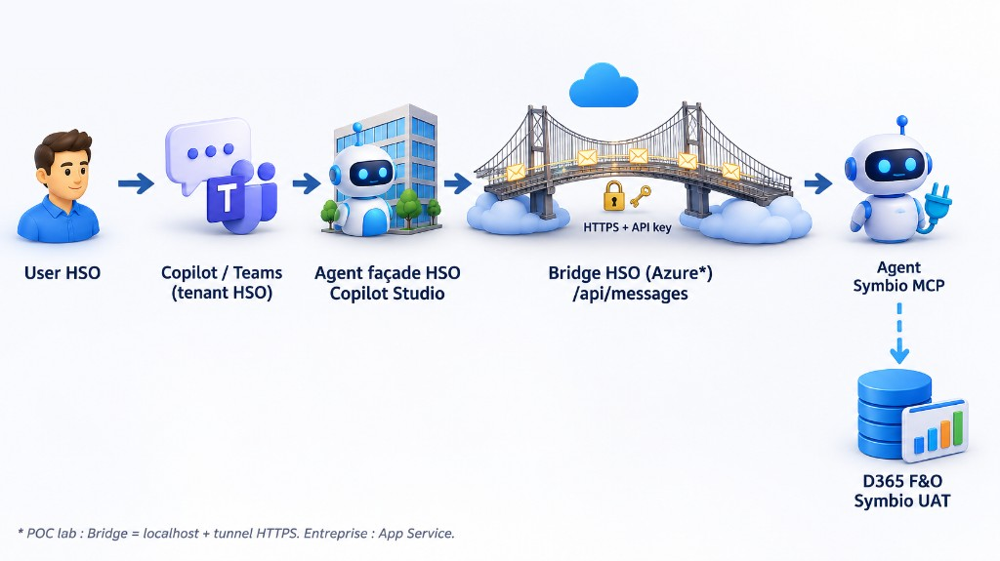

# POC Agent MCP — Symbio D365 → Copilot HSO

Projet IDE pour exposer l’agent Copilot Studio **Symbio D365 UAT MCP** (tenant client) vers le **Copilot interne HSO**, via un bridge Microsoft 365 Agents SDK.

## Chemin local (Cursor IDE)

Ouvre ce dossier dans Cursor Desktop :

```text
C:\Users\WalidHassayoune\OneDrive - HSO\Documents\Travail\HSO\Poc Agent MCP
```

Si tu clones ce dépôt, copie ou clone le contenu de `poc-agent-mcp/` dans ce chemin OneDrive, puis **File → Open Folder**.

## Objectif

| Composant | Où | Rôle |
|-----------|-----|------|
| Agent métier | Tenant **client** (Symbio) | MCP D365 UAT + consignes |
| Bridge | Azure / local HSO | Agents SDK → agent client |
| Agent façade | Tenant **HSO** | Copilot / Teams interne |

```text
[Copilot HSO] → [Agent façade HSO] → [Bridge] → [Symbio D365 UAT MCP] → [F&O …/mcp]
```



> Le mode multitenant Copilot Studio (preview) **ne supporte pas les outils MCP**. Ne pas l’utiliser pour cet agent.

## Structure

```text
poc-agent-mcp/
├── README.md
├── docs/                      # Étapes détaillées
├── config/                    # Templates (sans secrets)
├── bridge/                    # Squelette Node.js Agents SDK
└── .vscode/                   # Lancement IDE
```

## Documentation

| Doc | Contenu |
|-----|---------|
| [`docs/01-architecture.md`](docs/01-architecture.md) | Architecture explicative (flux, identités, invariants, état POC) |
| [`docs/06-mode-operatoire.md`](docs/06-mode-operatoire.md) | Mode opératoire lab (Entra, bridge, tunnel, façade, dépannage) |
| [`docs/07-enterprise-bridge-azure.md`](docs/07-enterprise-bridge-azure.md) | Delta entreprise — Bridge Azure |
| [`docs/08-mode-operatoire-technique-clients.md`](docs/08-mode-operatoire-technique-clients.md) | **Mode opératoire multi-clients (à partager)** |
| [`docs/02-copilot-studio-client.md`](docs/02-copilot-studio-client.md) | Checklist agent Symbio / F&O |
| [`docs/03-bridge-hso.md`](docs/03-bridge-hso.md) | Bridge & déploiement Azure |
| [`docs/04-agent-facade-hso.md`](docs/04-agent-facade-hso.md) | Façade & Connected agent |
| [`docs/05-agent-devops.md`](docs/05-agent-devops.md) | Piste ADO MCP (après D365) |

## Démarrage rapide

1. Lire [`docs/01-architecture.md`](docs/01-architecture.md) puis suivre [`docs/06-mode-operatoire.md`](docs/06-mode-operatoire.md)
2. Remplir `bridge/.env` depuis `config/agent.client.example.env` (gitignored)
3. Checklist agent Symbio : [`docs/02-copilot-studio-client.md`](docs/02-copilot-studio-client.md)
4. Bridge + tunnel + façade : sections D–F du mode opératoire
5. (Optionnel) Agent DevOps : [`docs/05-agent-devops.md`](docs/05-agent-devops.md)

### Bridge local

```powershell
cd bridge
npm install
copy ..\config\agent.client.example.env .env
# Éditer .env avec EnvironmentId, SchemaName, TenantId client, AppClientId
npm run dev
```

## Identifiants connus (agent client Published)

| Champ | Valeur |
|-------|--------|
| Nom | `Symbio D365 UAT MCP` |
| Environment ID | `4f680da5-2dcc-eace-a4eb-9787feeef742` |
| Bot / Schema | `cr10d_symbiod365uatmcp_9v0lfl` |
| MCP F&O | `https://symbiouat.sandbox.operations.eu.dynamics.com/mcp` |
| F&O base | `https://symbiouat.sandbox.operations.eu.dynamics.com/` |
| ADO org | `https://dev.azure.com/symbiofcell/` |
| ADO MCP | `https://mcp.dev.azure.com/symbiofcell` |

La **chaîne de connexion** Agents SDK se copie dans Copilot Studio → Canaux / Application (ne pas committer).

## Court terme (sans bridge)

Consultants HSO en **guest B2B** sur le tenant Symbio + users F&O → utiliser l’agent dans Copilot/Teams **client**. Valide le métier ; le bridge reste la cible Copilot HSO.
