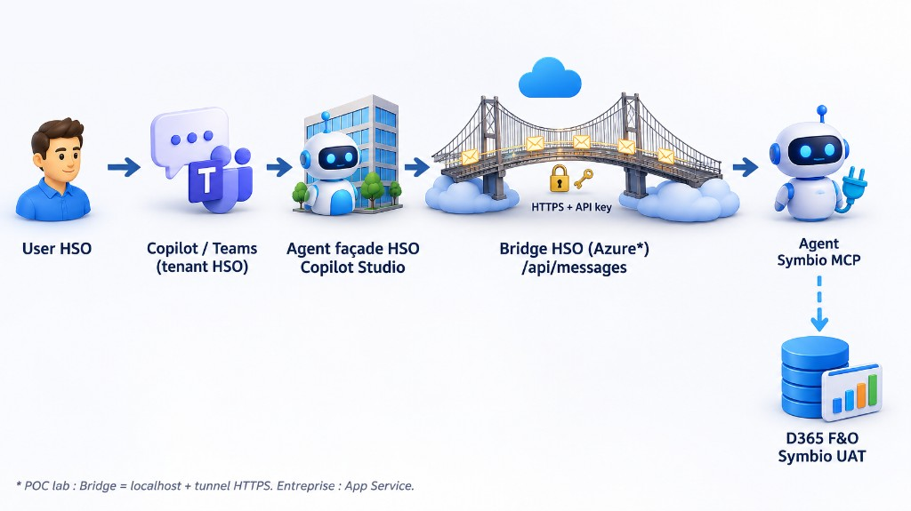

# Architecture — POC Copilot HSO ↔ Symbio D365 UAT MCP

Document d’architecture explicative du POC.  
Public : architectes, développeurs, admins Entra / Power Platform.

## 1. Objectif métier

Permettre à un utilisateur **HSO** (Copilot / Teams sur le tenant HSO) d’interroger / agir sur **Dynamics 365 F&O Symbio UAT** via l’agent Copilot Studio déjà publié côté client (**Symbio D365 UAT MCP**), **sans** recréer les tools MCP sur HSO et **sans** activer le mode multitenant Copilot Studio (MCP Dynamics ERP non supporté en multitenant).

## 2. Décision architecturale

| Option | Verdict POC |
|--------|-------------|
| Multitenant Copilot Studio | Rejeté — MCP non supporté |
| Guests HSO sur Copilot **client** | Court terme OK pour valider le métier ; ne prouve pas Copilot HSO |
| Recréer l’agent + MCP sur HSO | Auth F&O lourde ; duplique l’agent Symbio |
| **Bridge Agents SDK + façade HSO** | **Cible POC** |

Le MCP Dynamics 365 ERP exige une identité authentifiée dans F&O. L’agent métier (tools + connexion MCP) reste hébergé là où Dataverse / Copilot Studio client et la connexion F&O existent (**tenant Symbio**).

Le bridge HSO est un **proxy Activity Protocol** : il ne réimplémente pas les tools F&O ; il invoque l’agent Symbio via le client Microsoft 365 Agents SDK.

> **Hors scope POC (autre pattern)** : le repo `HSOFR-MCP-Server` (serveur MCP .NET custom PayFlow) n’est **pas** ce bridge. Ce sont deux architectures distinctes (tools MCP owned HSO vs invoke d’un agent Copilot Studio client).

## 3. Vue d’ensemble

### 3.1 Schéma d’architecture



**Flux :** User HSO → Copilot / Teams (tenant HSO) → Agent façade HSO (Copilot Studio) → Bridge HSO `/api/messages` (HTTPS + API key) → Agent Symbio MCP → D365 F&O Symbio UAT.

> \* POC lab : Bridge = `localhost` + tunnel HTTPS. **Entreprise : Azure App Service.**

### Composants

| Composant | Localisation | Responsabilité |
|-----------|--------------|----------------|
| Agent métier | Copilot Studio **Symbio** | Orchestration + MCP F&O |
| Bridge | Code HSO (`poc-agent-mcp/bridge`) | `POST /api/messages` → Agents SDK → agent Symbio |
| Tunnel (POC local) | Cloudflare / Dev Tunnel | HTTPS public → `localhost:3978` |
| Agent façade | Copilot Studio **HSO** | Routing ; Connected agent vers le bridge |
| Canal | M365 Copilot / Teams HSO | Expérience utilisateur |

## 4. Identités et confiance

```text
(1) User → Façade HSO          Entra HSO (SSO Copilot/Teams)
(2) Façade → Bridge            API key partagée (header x-api-key)
(3) Bridge → Agent Symbio      Token Entra Power Platform
                               scope Delegated: CopilotStudio.Copilots.Invoke
(4) Agent Symbio → MCP F&O     Identité de la connexion MCP (user F&O / guest)
```

### Auth bridge → Symbio (choix POC)

| Mode | `AUTH_MODE` | Permission Entra | Usage |
|------|-------------|------------------|--------|
| **Interactive (recommandé POC)** | `interactive` | **Delegated** `CopilotStudio.Copilots.Invoke` | Navigateur localhost ; contourne souvent le blocage Conditional Access du device code |
| Device code | `device_code` | Delegated | Souvent bloqué par CA Symbio |
| Client credentials | `client_credentials` | **Application** `CopilotStudio.Copilots.Invoke` + admin consent | Silent ; 403 si seule la Delegated est configurée |

**App Entra POC** : `APP_CLIENT_ID` public client, redirect `http://localhost`, public client flows = Yes, authority = tenant Symbio (`CLIENT_TENANT_ID`).

## 5. Contrats techniques

### 5.1 Façade → Bridge (Activity Protocol)

- **Méthode** : `POST /api/messages`
- **Auth** : header `x-api-key` = `BRIDGE_API_KEY` (alphanumérique recommandé ; éviter `/` `+` `=` qui perturbent parfois APIM)
- **Body** : Activity Bot Framework (`type`, `text`, `conversation`, `from`, …)
- **Réponse** : Activity message (ou tableau) avec `text` de réponse
- **Santé** : `GET /health` (sans clé)

### 5.2 Bridge → Symbio (Agents SDK)

- Package : `@microsoft/agents-copilotstudio-client`
- Cible : `CONNECTION_STRING` (DirectConnect URL) **ou** `ENVIRONMENT_ID` + `SCHEMA_NAME`
- Token : MSAL Node (`interactive` / `device_code` / `client_credentials`)

Identifiants agent Symbio (POC) :

| Champ | Valeur |
|-------|--------|
| Nom | Symbio D365 UAT MCP |
| Environment ID | `4f680da5-2dcc-eace-a4eb-9787feeef742` |
| Schema | `cr10d_symbiod365uatmcp_9v0lfl` |
| Tenant Symbio | `7d842853-a1df-4c03-a44c-b4cd5bdbb496` |

## 6. Facturation & conformité

- Crédits Copilot Studio de l’**agent métier** : consommés sur le tenant **hôte = Symbio**.
- Capacité Symbio à **0** (prépayé / PAYG) → l’invoke réussit techniquement mais l’agent répond *out of credits*.
- Ne pas activer « No authentication » en prod pour un agent lié à F&O.
- Préférer une identité consultant (guest) pour la traçabilité MCP quand le flux user est utilisé.

## 7. Déploiement cible entreprise vs POC local

Le POC (laptop + tunnel) **prouve le pattern**. La cible entreprise est un **bridge managé non local**.

```text
Entreprise:
  Copilot HSO → Façade → https://<bridge-hso>.azurewebsites.net/api/messages
                         → App Service (Node) + Key Vault
                         → client_credentials → Agent Symbio → MCP F&O
```

| | POC local (lab) | **Cible entreprise** |
|--|-----------------|----------------------|
| Bridge | Node sur poste | **Azure App Service Node 22** (ou Container Apps) |
| Exposition | Cloudflare / Dev Tunnel (URL éphémère) | HTTPS stable App Service |
| Secrets | `bridge/.env` | **Key Vault** + Managed Identity |
| Auth Symbio | `AUTH_MODE=interactive` (Delegated) | **`client_credentials`** + permission **Application** + admin consent |
| Façade Connected agent | URL tunnel | `https://<app>.azurewebsites.net/api/messages` |
| Observabilité | Logs console | Application Insights |

Delta exact (quoi modifier) : **[07-enterprise-bridge-azure.md](07-enterprise-bridge-azure.md)**.

## 8. État de validation POC (référence)

| Étape | Statut |
|-------|--------|
| Bridge local + health | Validé |
| Invoke Symbio (interactive + connection string) | Validé (réponse agent) |
| Contenu métier F&O | Bloqué — **crédits Copilot Symbio** |
| Façade HSO → Connected agent → tunnel | Fragile — URL tunnel à republier à chaque redémarrage ; erreurs 500/502 APIM si mauvais endpoint |
| Device code | Bloqué CA Symbio |
| Client credentials | Token OK ; invoke 403 sans permission **Application** |

## 9. Invariants (à ne pas casser)

1. L’agent MCP F&O reste sur le **tenant Symbio** (pas de multitenant CS pour cet agent).
2. La façade HSO ne porte **pas** le tool Dynamics 365 ERP MCP.
3. Le bridge ne commit **jamais** connection string / secrets.
4. Le Connected agent pointe toujours vers un **HTTPS public** joignable depuis Power Platform (pas `localhost` nu).
5. `BRIDGE_API_KEY` côté façade = valeur exacte du bridge.

## 10. Documents associés

| Doc | Contenu |
|-----|---------|
| [06-mode-operatoire.md](06-mode-operatoire.md) | Mode opératoire détaillé (runbook lab) |
| [07-enterprise-bridge-azure.md](07-enterprise-bridge-azure.md) | Delta entreprise — Bridge Azure |
| [08-mode-operatoire-technique-clients.md](08-mode-operatoire-technique-clients.md) | Mode opératoire multi-clients + package zip |
| [02-copilot-studio-client.md](02-copilot-studio-client.md) | Checklist agent Symbio / F&O |
| [03-bridge-hso.md](03-bridge-hso.md) | Bridge & Entra |
| [04-agent-facade-hso.md](04-agent-facade-hso.md) | Façade & Connected agent |
| [05-agent-devops.md](05-agent-devops.md) | Piste ADO MCP (après D365) |
