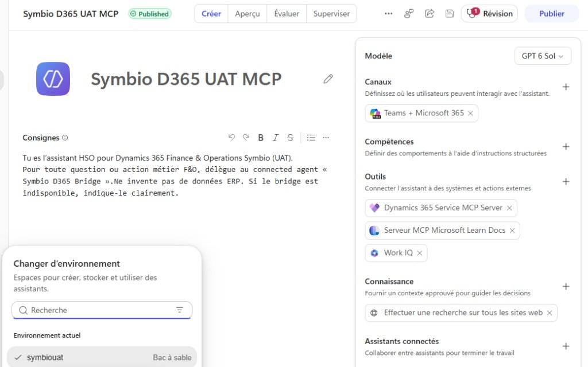

# Agent métier — tenant client (Symbio)

## État actuel

Agent **Symbio D365 UAT MCP** : **Published** (environnement Power Platform **symbiouat** — bac à sable).

Récupérer dans Copilot Studio (tenant client) :

1. **Settings → Advanced → Metadata** : Environment ID, Schema name
2. **Canaux → Application / Web app** : chaîne Microsoft 365 Agents SDK
3. Coller dans `bridge/.env` (non versionné) — ne jamais committer secrets / connection string

### Référence UI (capture)

| Élément | Valeur observée POC |
|---------|---------------------|
| Nom | `Symbio D365 UAT MCP` |
| Statut | Published |
| Environnement | `symbiouat` (sandbox) |
| Canaux | Teams + Microsoft 365 |
| Outils (ex.) | Dynamics 365 Service MCP Server, Microsoft Learn Docs MCP, Work IQ |

> Le bridge invoque cet agent via Agents SDK ; les tools MCP F&O restent côté **tenant Symbio**, pas sur HSO.

## Checklist F&O UAT

Sur `https://symbiouat.sandbox.operations.eu.dynamics.com/` :

1. Feature **Dynamics 365 ERP Model Context Protocol server** activée
2. **System administration → Setup → Allowed MCP clients**  
   Copilot Studio `Allowed = Yes`  
   Client ID : `7ab7862c-4c57-491e-8a45-d52a7e023983`
3. Version ≥ 10.0.47 (ou PQU équivalent), Tier 2+
4. Users F&O + rôles pour les consultants HSO (guests) ou compte de test POC

## Checklist Copilot Studio (client)

1. Auth agent : **Authenticate with Microsoft**
2. Orchestration generative : ON
3. Modèle : Claude Sonnet 4.5 (sinon GPT-5 Chat)
4. Tool : **Dynamics 365 ERP MCP** (pas la version static/Preview retirée)
5. Connexion créée avec un compte qui a accès F&O UAT
6. Publish à jour après chaque changement

## Isolation tenant (Power Platform Admin Center)

Si l’isolation est active sur le tenant client :

- Autoriser le tenant **HSO** en outbound (et inbound si besoin) pour que le bridge / les guests puissent invoquer l’agent

## Ne pas faire

- Activer le **mode multitenant** Copilot Studio pour cet agent (MCP non supporté)
- Committer la chaîne de connexion ou des secrets
