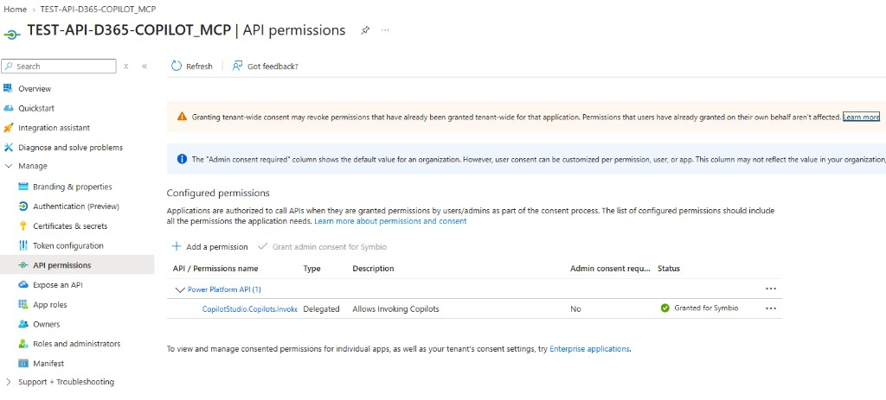

# Bridge HSO — Microsoft 365 Agents SDK

Le bridge est une API Activity Protocol (`POST /api/messages`) hébergée côté HSO.  
Copilot Studio HSO l’ajoute comme **connected agent** ; le bridge appelle l’agent client via le SDK.

## Prérequis Entra

1. App registration (public client pour le POC local, ou confidential pour Azure)  
   Exemple POC : `TEST-API-D365-COPILOT_MCP` → `APP_CLIENT_ID` dans `bridge/.env`
2. Redirect URI local : `http://localhost` (console) ou `http://localhost:3978` (HTTP)
3. API permissions → **APIs my organization uses** → **Power Platform API**  
   Delegated : `CopilotStudio.Copilots.Invoke`
4. **Grant admin consent** (statut attendu : *Granted for Symbio*)
5. Pour cross-tenant : app **multi-tenant** et/ou users HSO en guest sur le tenant Symbio



## Config

Copier `config/agent.client.example.env` vers `bridge/.env` :

```env
PORT=3978
CLIENT_TENANT_ID=<tenant-id-symbio>
ENVIRONMENT_ID=4f680da5-2dcc-eace-a4eb-9787feeef742
SCHEMA_NAME=cr10d_symbiod365uatmcp_<suffix>
APP_CLIENT_ID=<app-registration-hso-or-client>
# Option : DIRECT_CONNECT_URL=<chaîne Agents SDK complète>
BRIDGE_API_KEY=<clé-partagée-avec-copilot-hso>
```

## Lancer en local (Visual Studio Code)

Depuis la racine du repo cloné :

```powershell
cd bridge
npm install
npm run dev
```

Health check : `GET http://localhost:3978/health`

## Déploiement Azure (cible entreprise)

Voir le delta exact : [`07-enterprise-bridge-azure.md`](07-enterprise-bridge-azure.md).

1. App Service (Node 22 LTS) ou Container Apps  
2. `AUTH_MODE=client_credentials` + permission **Application** + Key Vault  
3. HTTPS : `https://<app>.azurewebsites.net/api/messages`  
4. Connected agent HSO → cette URL (plus de tunnel)  
5. Auth façade : header `x-api-key` = `BRIDGE_API_KEY`

## Références

- [Integrate web/native apps with Agents SDK](https://learn.microsoft.com/en-us/microsoft-copilot-studio/publication-integrate-web-or-native-app-m365-agents-sdk)
- Samples : [microsoft/Agents](https://github.com/microsoft/Agents)
