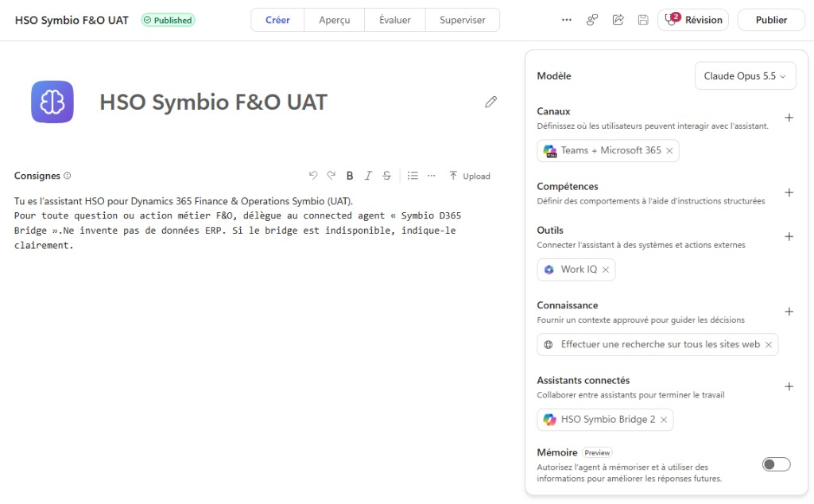

# Agent façade — Copilot interne HSO

## Création

1. [copilotstudio.microsoft.com](https://copilotstudio.microsoft.com) → environnement **HSO**
2. **Create** → blank agent  
   Nom : `HSO Symbio F&O UAT`
3. Orchestration generative : ON
4. Instructions (POC) :

```text
Tu es l’assistant HSO pour Dynamics 365 Finance & Operations Symbio (UAT).
Pour toute question ou action métier F&O, délègue au connected agent « Symbio D365 Bridge ».
Ne invente pas de données ERP. Si le bridge est indisponible, indique-le clairement.
```



### Référence UI (capture)

| Élément | Valeur observée POC |
|---------|---------------------|
| Nom | `HSO Symbio F&O UAT` |
| Statut | Published |
| Modèle | Claude Opus 5.5 (exemple POC) |
| Canaux | Teams + Microsoft 365 |
| Assistants connectés | `HSO Symbio Bridge 2` (SDK → bridge) |

> Aligner le **nom** cité dans les consignes avec le nom réel du connected agent (ex. consignes « Symbio D365 Bridge » vs UI « HSO Symbio Bridge 2 ») pour un routing fiable.

## Connected agent (SDK)

1. **Build → Connected agents / Assistants connectés → Add**
2. **Microsoft 365 Agents SDK agent**
3. Messaging endpoint :
   - Local test (tunnel) : `https://<tunnel>/api/messages`
   - Prod : `https://<bridge-hso>/api/messages`
4. Name : ex. `HSO Symbio Bridge 2` ou `Symbio D365 Bridge` (≤ 30 car.) — **même libellé** que dans les consignes
5. Description riche (routing) : F&O, clients, commandes, inventaire, Symbio UAT…
6. Auth : **API key** → même valeur que `BRIDGE_API_KEY` (header `x-api-key`)
7. Add to agent → Publish

**Ne pas** ajouter le tool Dynamics 365 ERP MCP sur la façade HSO.

## Canal Copilot HSO

1. Canaux → **Microsoft 365 Copilot** / Teams
2. Publier / rendre disponible selon la gouvernance HSO (admin MAC si besoin)

## Tests

1. Dans Copilot HSO : « Liste les clients actifs sur Symbio UAT »
2. Vérifier les logs du bridge (`POST /api/messages`)
3. Vérifier l’appel MCP côté agent client (Superviser / Test chat client)
