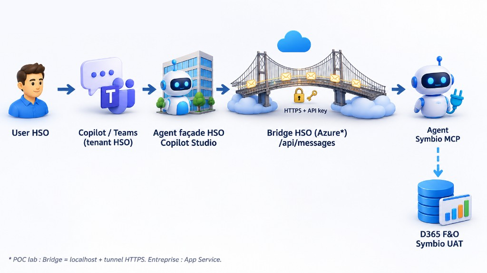

# Cible entreprise — Bridge Azure (delta exact vs POC)

Le POC a validé le **pattern**. Ce document liste **exactement** ce qu’il faut modifier pour un bridge **non local**.

## 0. Schéma d’architecture



En entreprise, le **Bridge HSO** = **App Service** (`https://<app>.azurewebsites.net/api/messages`) — pas de laptop ni de tunnel.  
Schéma partagé avec [01-architecture.md](01-architecture.md).

## 1. Ce qui ne change pas

| Élément | Inchangé |
|---------|----------|
| Flux métier | Façade HSO → Connected agent → Bridge → Agent Symbio → MCP F&O |
| Contrat HTTP | `POST /api/messages`, `GET /health`, header `x-api-key` |
| Code métier bridge | `askSymbioAgent` + Activity Protocol |
| Agent Symbio | Published, même `CONNECTION_STRING` / schema |
| Façade HSO | Même agent ; **seul** le messaging endpoint change |
| Interdit | Multitenant CS sur l’agent MCP ; MCP F&O sur la façade HSO |

## 2. Ce qui change (résumé)

```text
POC:     Copilot → tunnel → localhost:3978 (interactive login)
Entreprise: Copilot → https://<bridge>.azurewebsites.net/api/messages
                      (client_credentials, secrets dans Key Vault)
```

---

## 3. Modifications Entra (Symbio) — obligatoire

Sur l’app `APP_CLIENT_ID` (ou nouvelle app **confidential** dédiée prod) :

| Action | Détail |
|--------|--------|
| 1. Type | Confidential client (secret **ou** certificat — cert préférable) |
| 2. Permission | **Application** (pas seulement Delegated) : Power Platform API → `CopilotStudio.Copilots.Invoke` |
| 3. Consent | **Grant admin consent for Symbio** |
| 4. Redirect localhost | Optionnel en prod (plus besoin pour interactive) |
| 5. Secret | Créer un secret (ou cert) → stocker **uniquement** dans Key Vault |

Sans l’étape 2+3 → token OK mais invoke **403** (vu en POC).

---

## 4. Modifications configuration bridge

### 4.1 Variables d’environnement (App Settings / Key Vault)

| Variable | POC local | Entreprise |
|----------|-----------|------------|
| `PORT` | `3978` | Fourni par App Service (ne pas forcer en dur) |
| `MOCK_MODE` | `false` | `false` |
| `AUTH_MODE` | `interactive` | **`client_credentials`** |
| `APP_CLIENT_ID` | public client | Même ou app confidential prod |
| `APP_CLIENT_SECRET` | commenté | **Requis** (réf. Key Vault) |
| `CLIENT_TENANT_ID` | Symbio GUID | Inchangé |
| `CONNECTION_STRING` | DirectConnect URL | Inchangé (Key Vault) |
| `ENVIRONMENT_ID` / `SCHEMA_NAME` | fallback | Inchangé |
| `BRIDGE_API_KEY` | local | Nouvelle clé forte alphanumérique (Key Vault) |

Fichier local `.env` : **ne plus** servir en prod. Template : `config/agent.client.example.env`.

### 4.2 Code déjà prêt (peu ou pas de refactor)

| Fichier | Action entreprise |
|---------|-------------------|
| `bridge/src/auth.ts` | **Aucune** si `AUTH_MODE=client_credentials` + secret |
| `bridge/src/config.ts` | **Aucune** (lit déjà les env vars) |
| `bridge/src/copilotClient.ts` | **Aucune** |
| `bridge/src/server.ts` | Écouter `0.0.0.0` (containers) — petit patch |
| `bridge/package.json` | Scripts `build` + `start` production |

---

## 5. Modifications infrastructure Azure (HSO)

Créer (subscription / RG HSO) :

1. **App Service** — Runtime **Node 22 LTS**, OS Linux (ou Windows)
2. **Key Vault** — secrets : `CONNECTION-STRING`, `APP-CLIENT-SECRET`, `BRIDGE-API-KEY`
3. **Managed Identity** sur l’App Service → accès Key Vault (get secrets)
4. (Recommandé) **Application Insights**
5. (Optionnel) custom domain + TLS managé

### App Settings (exemples de noms)

```text
MOCK_MODE=false
AUTH_MODE=client_credentials
CLIENT_TENANT_ID=7d842853-a1df-4c03-a44c-b4cd5bdbb496
ENVIRONMENT_ID=4f680da5-2dcc-eace-a4eb-9787feeef742
SCHEMA_NAME=cr10d_symbiod365uatmcp_9v0lfl
APP_CLIENT_ID=<prod-app-id>
WEBSITE_NODE_DEFAULT_VERSION=~22
# Secrets via Key Vault references, ex. :
# APP_CLIENT_SECRET=@Microsoft.KeyVault(SecretUri=https://<kv>.vault.azure.net/secrets/APP-CLIENT-SECRET/)
# CONNECTION_STRING=@Microsoft.KeyVault(...)
# BRIDGE_API_KEY=@Microsoft.KeyVault(...)
```

### Startup

```text
npm run start
```

(après `npm ci` + `npm run build` en pipeline, ou Oryx build)

### URL Connected agent

```text
https://<app-name>.azurewebsites.net/api/messages
```

Smoke :

```text
GET  https://<app-name>.azurewebsites.net/health
POST https://<app-name>.azurewebsites.net/api/messages  (+ x-api-key)
```

---

## 6. Modifications Copilot Studio HSO (façade)

| Champ Connected agent | Avant (POC) | Après (entreprise) |
|----------------------|-------------|---------------------|
| Messaging endpoint | `https://….trycloudflare.com/api/messages` | `https://<app>.azurewebsites.net/api/messages` |
| API key | clé labo | **nouvelle** clé Key Vault (même valeur que `BRIDGE_API_KEY`) |
| Auth type | API key / `x-api-key` | Inchangé (MVP) |

Puis **Publish** la façade.  
Supprimer toute référence tunnel / localhost.

---

## 7. Modifications pipeline / repo

| Élément | Action |
|---------|--------|
| `.gitignore` | Garder `bridge/.env` ignoré |
| Pipeline CI | `npm ci` → `npm run build` → deploy zip/container vers App Service |
| Artefacts | Ne jamais packager `.env` |
| Infra as Code | Optionnel : Bicep/Terraform App Service + KV (phase 2) |

---

## 8. Checklist d’application (ordre)

1. [ ] Symbio : permission **Application** + admin consent sur l’app bridge  
2. [ ] Symbio : confirmer **crédits** Copilot sur l’environnement agent  
3. [ ] HSO Azure : App Service Node 22 + Key Vault + MI  
4. [ ] Renseigner App Settings (table §4.1)  
5. [ ] Déployer le code `bridge/` (`build` + `start`)  
6. [ ] `GET /health` → `ok: true`, `authMode: client_credentials`  
7. [ ] `POST /api/messages` avec API key (smoke hors façade)  
8. [ ] Copilot Studio HSO : mettre à jour endpoint + API key → **Publish**  
9. [ ] Test Copilot HSO → log App Insights / bridge sans tunnel  
10. [ ] Retirer tunnels labo de la doc d’exploitation (garder en annexe lab)

---

## 9. Phasage recommandé

| Phase | Scope |
|-------|--------|
| **E1** | App Service + KV + `client_credentials` + Connected agent URL stable |
| **E2** | App Insights, alertes 5xx, rotation secrets, runbook ops |
| **E3** | Auth façade OAuth / Easy Auth ; cert au lieu de client secret ; revue OBO si traçabilité user F&O exigée |

## 10. Non-objectifs entreprise (ne pas faire)

- Remplacer le bridge par `HSOFR-MCP-Server` sans arbitrage produit  
- Héberger le MCP F&O sur le tenant HSO « pour simplifier »  
- Garder `AUTH_MODE=interactive` sur App Service (pas de navigateur serveur)  
- URL tunnel dans la config Connected agent de prod
