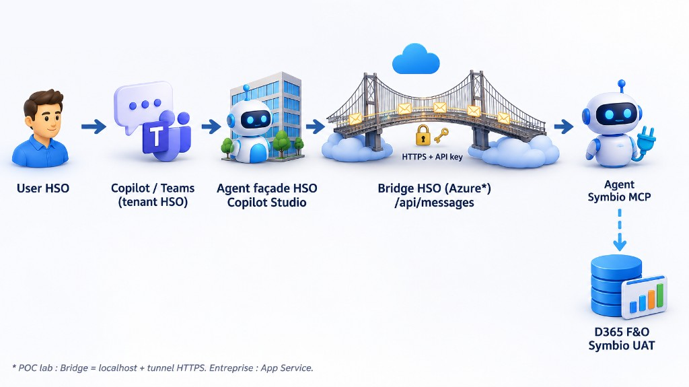

# Mode opératoire technique — Bridge Agents SDK (déploiement multi-clients)

Document **partageable** pour les équipes HSO qui répliquent le pattern chez d’autres clients.  
Indépendant de Symbio : remplacer chaque placeholder `<…>` par les valeurs du client.

**Livrable associé :** package bridge `share/hso-copilot-studio-bridge-*.zip` (sources + docs, **sans secrets**).

Schéma :



---

## 0. Prérequis

| # | Prérequis | Notes |
|---|-----------|--------|
| 0.1 | Node.js **≥ 22** | Build & run bridge |
| 0.2 | Accès Copilot Studio **tenant client** | Agent métier Published + MCP si besoin |
| 0.3 | Accès Copilot Studio **tenant HSO** (ou tenant partenaire) | Agent façade |
| 0.4 | Droit de créer une **App registration** Entra (souvent sur tenant **client**) | Invoke Power Platform |
| 0.5 | Capacité Copilot Studio (crédits / PAYG) sur l’env de l’agent métier | Bloquant runtime |
| 0.6 | Abonnement Azure HSO (cible entreprise) | App Service + Key Vault |

---

## 1. Package bridge — réception & démarrage lab

### Étape 1.1 — Extraire le zip

```powershell
Expand-Archive .\hso-copilot-studio-bridge-*.zip -DestinationPath .\hso-bridge -Force
cd .\hso-bridge\bridge
```

Contenu attendu :

```text
bridge/
  src/           # server, auth, config, copilotClient
  package.json
  package-lock.json
  tsconfig.json
  .env.example
docs/            # architecture + ce mode opératoire
README-SHARE.md
```

### Étape 1.2 — Installer

```powershell
npm ci
# ou: npm install
```

### Étape 1.3 — Configurer `.env`

```powershell
Copy-Item .env.example .env
notepad .env
```

Renseigner (lab) :

| Variable | Description |
|----------|-------------|
| `CLIENT_TENANT_ID` | GUID tenant Entra où vit l’agent métier |
| `CONNECTION_STRING` | URL Agents SDK (Channels → Web/Native app) **ou** |
| `ENVIRONMENT_ID` + `SCHEMA_NAME` | Metadata agent |
| `APP_CLIENT_ID` | App Entra (voir §2) |
| `AUTH_MODE` | `interactive` (lab) |
| `BRIDGE_API_KEY` | Clé **alphanumérique** (partagée avec Connected agent) |
| `MOCK_MODE` | `false` pour appeler l’agent réel |

### Étape 1.4 — Lancer

```powershell
npm run dev
curl.exe http://localhost:3978/health
```

Attendu : `"ok":true`.

---

## 2. Entra — App pour invoke l’agent client

### Étape 2.1 — Créer l’app (lab = public client)

1. Entra **tenant client** (recommandé) → App registrations → New  
2. **Mobile and desktop** → Redirect : `http://localhost`  
3. **Allow public client flows** = Yes  
4. API permissions → **Power Platform API** → **Delegated** `CopilotStudio.Copilots.Invoke`  
5. Admin consent si requis  
6. Copier **Application (client) ID** → `APP_CLIENT_ID`

### Étape 2.2 — Entreprise (App Service)

1. Même app (ou app dédiée) en **confidential** + secret/cert  
2. Ajouter permission **Application** `CopilotStudio.Copilots.Invoke`  
3. **Grant admin consent**  
4. `AUTH_MODE=client_credentials` + `APP_CLIENT_SECRET` (Key Vault)

> Si seule Delegated est présente → `client_credentials` obtient un token mais invoke **403**.

### Étape 2.3 — Conditional Access

Si *Accès impossible* après login : exclusion CA pour compte/app POC, ou rester en `interactive` / passer en Application permission pour Azure.

---

## 3. Agent métier (tenant client)

### Étape 3.1 — Vérifier / publier

1. Copilot Studio client → agent métier (MCP F&O ou autre)  
2. Auth agent adaptée (souvent Authenticate with Microsoft)  
3. **Publish**

### Étape 3.2 — Récupérer la cible Agents SDK

1. **Channels** → Web app / Native app → **Microsoft 365 Agents SDK** → Copy  
   → `CONNECTION_STRING`  
2. Ou Settings → Advanced → Metadata → `ENVIRONMENT_ID`, `SCHEMA_NAME`

### Étape 3.3 — Capacité

Power Platform Admin → Copilot Studio : crédits / PAYG **> 0** sur l’environnement de l’agent.

---

## 4. Exposer le bridge (lab)

Copilot cloud ne joindra jamais `localhost` seul.

### Étape 4.1 — Tunnel (lab uniquement)

```powershell
# Exemple Cloudflare
cloudflared tunnel --url http://localhost:3978
```

### Étape 4.2 — Vérifier

```powershell
curl.exe https://<tunnel-host>/health
```

Messaging endpoint Connected agent :

```text
https://<tunnel-host>/api/messages
```

> Chaque redémarrage de quick tunnel = **nouvelle URL** → republier le Connected agent.

---

## 5. Agent façade (tenant HSO / partenaire)

### Étape 5.1 — Créer la façade

1. Copilot Studio HSO → blank agent  
2. Orchestration generative ON  
3. Instructions : déléguer au connected agent ; ne pas inventer de données ERP  
4. **Ne pas** ajouter le MCP Dynamics sur la façade

### Étape 5.2 — Connected agent

1. Build → Connected agents → **Microsoft 365 Agents SDK agent**  
2. Endpoint : `https://<bridge-public>/api/messages`  
3. Auth : API key = `BRIDGE_API_KEY` (header `x-api-key`)  
4. Description riche pour le routing  
5. **Publish**

### Étape 5.3 — Canal

Channels → Microsoft 365 Copilot / Teams → publier selon gouvernance.

---

## 6. Tests (ordre imposé)

| # | Test | OK si |
|---|------|--------|
| 6.1 | `GET /health` local | `ok: true` |
| 6.2 | `POST /api/messages` local + API key | Réponse agent ou message crédits |
| 6.3 | `GET https://<public>/health` | 200 |
| 6.4 | Prompt sur façade HSO | Log bridge `POST /api/messages` |
| 6.5 | Cas métier F&O | Données réelles (crédits + MCP OK) |

Premier call `interactive` : navigateur → login compte du **tenant client**.

---

## 7. Cible entreprise (Azure) — étapes

Détail : [07-enterprise-bridge-azure.md](07-enterprise-bridge-azure.md).

| # | Action |
|---|--------|
| 7.1 | Entra : permission **Application** + consent |
| 7.2 | Azure : App Service Node 22 + Key Vault + MI |
| 7.3 | App Settings : `AUTH_MODE=client_credentials`, secrets KV |
| 7.4 | Deploy : `npm ci` → `npm run build` → `npm start` |
| 7.5 | Connected agent → `https://<app>.azurewebsites.net/api/messages` |
| 7.6 | Retirer tunnels lab de la config prod |

---

## 8. Matrice de dépannage (courte)

| Symptôme | Action |
|----------|--------|
| AADSTS500113 | Ajouter redirect `http://localhost` |
| Accès impossible (CA) | Exclusion CA / interactive / Application perm |
| 403 invoke | Permission **Application** + consent |
| out of credits | Crédits / PAYG env agent client |
| 502/503 Tunnel | Tunnel down ou mauvaise URL → republier |
| 500 APIM field name | API key alphanumérique ; header `x-api-key` |
| Pas de POST sur bridge | Endpoint / Publish / tunnel |

---

## 9. Checklist remise client

- [ ] Zip bridge extrait, `npm ci` OK  
- [ ] `.env` rempli (pas de secrets dans git/mail)  
- [ ] App Entra + permission adaptée (lab ou entreprise)  
- [ ] Connection string / metadata agent client  
- [ ] Crédits Copilot confirmés  
- [ ] Bridge up + health  
- [ ] Endpoint public (tunnel lab ou App Service)  
- [ ] Façade + Connected agent + Publish  
- [ ] Test E2E documenté (prompt + résultat)  
- [ ] Runbook ops + owners Entra / PP / Azure renseignés  

---

## 10. Règles de partage du zip

**Inclure :** `bridge/src`, `package.json`, `package-lock.json`, `tsconfig.json`, `.env.example`, docs architecture / mode opératoire / entreprise, schéma image.

**Exclure :** `.env`, `node_modules/`, `dist/`, secrets, connection strings réelles, captures avec credentials.

Régénérer le zip :

```powershell
# depuis poc-agent-mcp/
.\scripts\pack-bridge-share.ps1
```
